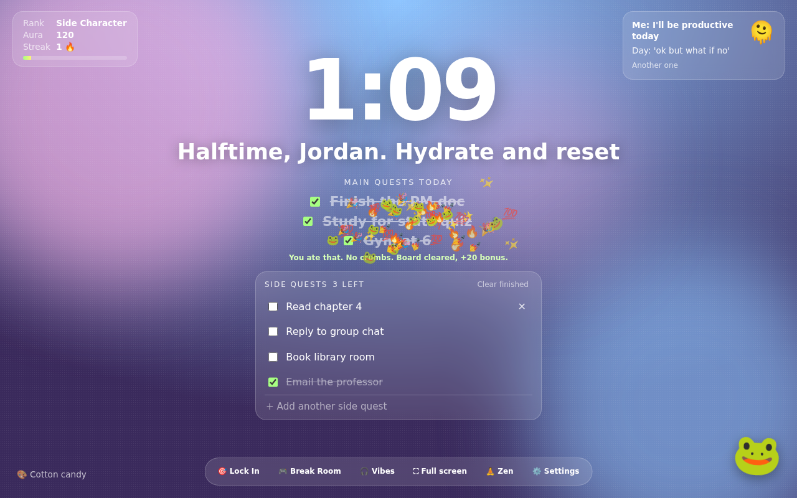
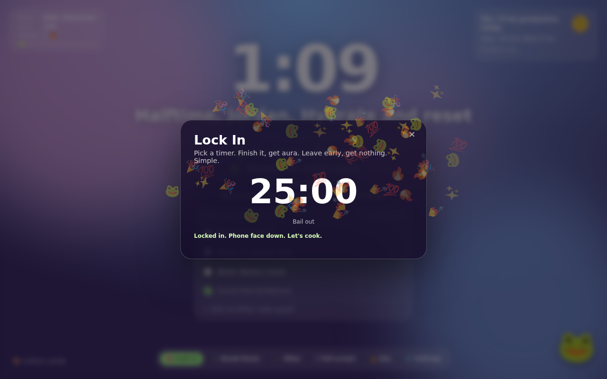
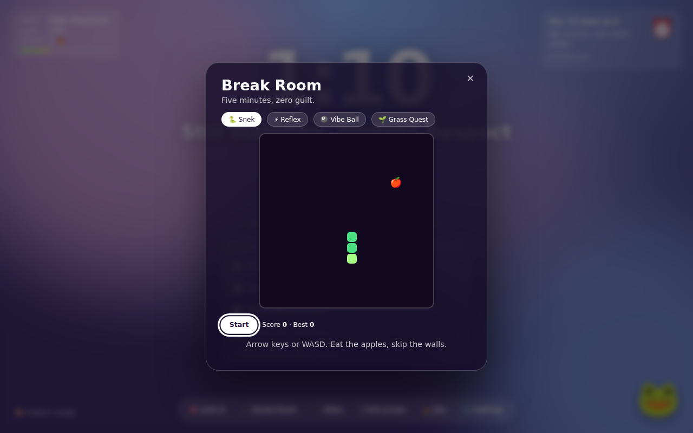
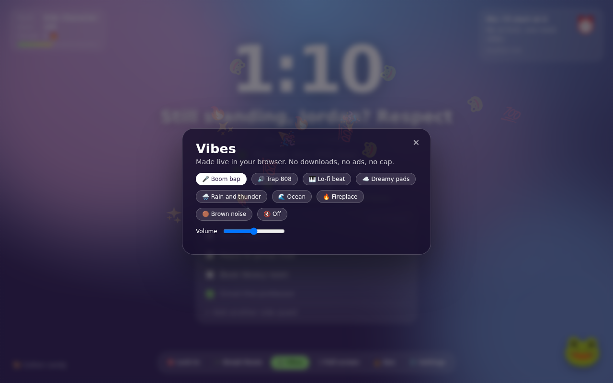
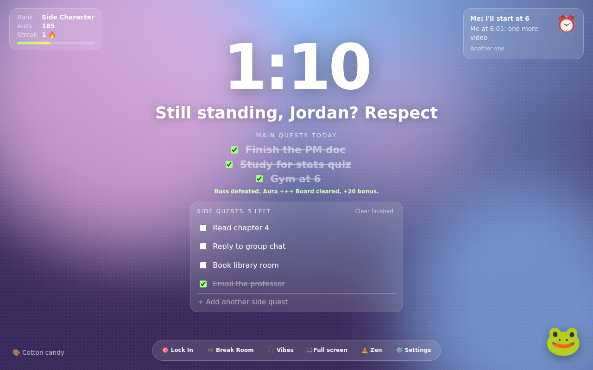
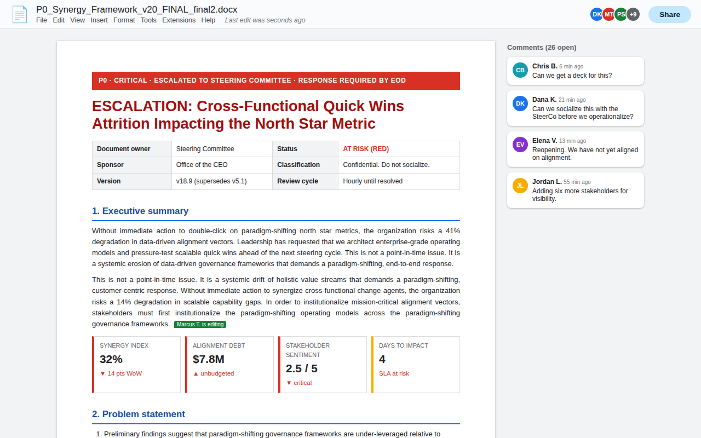

# Touch Grass Tab

A Momentum-style new tab for Chrome, rebuilt for students who need focus and a proper break. Clock, main quest, side quests, a lock-in timer, a Break Room with games, live-generated lo-fi and rain, memes, and a frog called Gregory. Everything stays on your device.

Full product doc and acceptance criteria: [docs/PM-DOC.md](docs/PM-DOC.md)

[](https://github.com/tacox2404-sudo/momentum-chrome-extension/actions/workflows/ci.yml)

## Download and try it

[Download the extension as a ZIP](https://github.com/tacox2404-sudo/momentum-chrome-extension/archive/refs/heads/main.zip), unzip it, then follow the install steps below and load the `extension` folder. It takes about 2 minutes and needs no account, server or internet connection.

## What it looks like

These screenshots were captured automatically by the end-to-end test (`npm run e2e`), so they show the real extension running in Chrome.

### Home: clock, main quests and side quests



The new tab shows the time, a greeting and up to 3 main quests for the day. Ticking them off earns aura, raises your rank and builds a streak (top left). Side quests are a lighter to-do list underneath. A meme card sits top right and Gregory the frog sits bottom right.

### Lock In timer



Pick 15, 25 or 45 minutes. Finishing the timer earns aura and leaving early earns nothing. The timer keeps running in the background and sends a notification when it ends.

### Break Room: mini games



Five-minute breaks with four small games: Snek, Reflex, Vibe Ball and Grass Quest.

### Vibes: sounds generated in the browser



Eight background sounds with a volume slider. All audio is generated live in the browser, so there are no downloads and no network requests.

### Zen mode



Press `Z` to hide everything except the clock and your quests.

### Boss key



Press `B` and the page instantly turns into a convincing, very buzzword-heavy fake document. Press it again to come back.

## Status and checks

- Built as a university project. The full product document (user stories, 15 acceptance criteria, risks and a demo script) is in [docs/PM-DOC.md](docs/PM-DOC.md).
- `npm run check` (22 static checks: Manifest V3, minimal permissions, no network code) runs automatically on every push through GitHub Actions (see the badge above).
- `npm run e2e` (25 end-to-end checks in Chromium) is run locally and produced the screenshots above. It is not part of the automatic checks because it needs a browser.
- Not covered by automatic tests: a real system notification when a timer ends, and how the sounds feel on real speakers.

## Install it (2 minutes)

1. Clone or download this repo.
2. Open `chrome://extensions` in Chrome.
3. Switch on **Developer mode** (top right).
4. Click **Load unpacked** and pick the `extension` folder.
5. Open a new tab.

## What is inside

| Feature | Where to find it |
|---|---|
| Time, greeting, up to 3 main quests, side quests | Center of the page |
| Lock In timer (15, 25, 45 min) | Dock, bottom |
| Break Room: Snek, Reflex, Vibe Ball, Grass Quest | Dock |
| Vibes: boom bap, trap 808, lo-fi beat, dreamy pads, rain, ocean, fireplace, brown noise | Dock |
| Aura, rank, streak | Top left |
| Meme card | Top right |
| Gregory | Bottom right, poke him |
| Boss key: a very urgent, very buzzword-heavy fake document | Press `B` |
| Full screen (hides Chrome's tab strip and toolbar) | Press `F` or the dock button |
| Zen mode (only clock and quests) | Press `Z` or the dock button |

## Test it

You need Node 20 or newer.

```bash
npm run check   # static checks: manifest, permissions, no network code
npm run e2e     # loads the extension in Chromium and walks every acceptance criterion
```

`npm run e2e` uses Playwright and saves screenshots to `docs/screenshots/`.

## Change the voice

All jokes, greetings, memes, ranks and colors live in `extension/js/slang.js`. Edit that file, reload the extension on `chrome://extensions`, and you are done.

## Layout

```
extension/     the actual Chrome extension (load this folder)
docs/          PM-Doc and screenshots
scripts/       icon generator, static checks, end-to-end test
```
